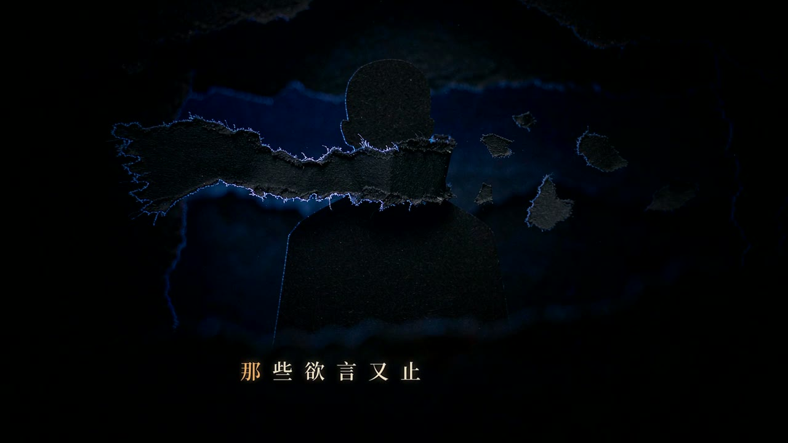

# Music_MV_Generation

**An agent skill that turns a song into a publishable music video** — analyse the track,
pick a visual language, write a shot list, generate stills and clips, cut to the beat,
burn per-character-synced lyrics, then ship a cover and a QC-checked MP4.

[中文](README.md) · English

| Storyboard still | Frame from the film | Cover |
|---|---|---|
|  |  |  |

30-second excerpt (paper-cut night city style): [`docs/results/preview-30s.mp4`](docs/results/preview-30s.mp4)

---

## What it is

An **agent skill**, not a double-clickable app. `SKILL.md` is the workflow an AI agent follows;
`references/` holds the per-stage playbooks (20 files); `scripts/` holds 36 runnable tools.
The division of labour is deliberate:

- **The model decides; the tools measure.** Timing, specs and loudness are always measured,
  never estimated by the model.
- **Generate many, keep few.** Every key choice has candidates, a score and an explicit cut.

## How it works — 4 human gates + post-publish feedback

```
⓪platform goal & references → ①analyse → ②style options ═gate 1═ → ③test frames ═gate 2═
→ ④retention-led story → ⑤dual-track shot list ═gate 3═ → ⑥prompts → ⑦stills → ⑧clips
→ ⑨title card → ⑩timeline → ⑪subtitles ═gate 4═ → ⑫QC → ⑬cover & copy → ⑭review
```

**Gate 2 is a one-time authorisation**: approving the three test frames also locks in
"the whole film is AI-generated", so the agent never asks again how to produce the shots.
**After gate 3 there is no further question until gate 4**: prompts → stills → clips → title →
timeline → subtitles run as one continuous pass. Stills done means clips start immediately.

Five mechanisms that make the output look intentional rather than generated:

1. **Three-layer scoring** (style / story / single shot) with hard red lines, e.g. a shot that
   cannot be generated from a still is rejected before any credit is spent.
2. **Subtitle recipes chosen from measurements** — 12 presets, picked by 8 features of the frame
   (luminance, gradient, saturation…), so text never lands on a busy area.
3. **Per-character lyric alignment** with a hard 0.3 s ceiling; every entry point goes through
   the same `align_subs.py`.
4. **The title card is typography inside the image**, not an overlay: the words must live on a
   physical carrier in the scene (paper banner, shop sign), so they bend with the artwork.
   Covers follow `references/07b-cover-brief.md` only — it is the single source of truth for
   cover design and prompting.
5. **Douyin narrative and review** — `12-douyin-narrative.md` defines hooks, retention and series identity;
   `13-douyin-storyboard.md` defines dual-track shot cards; `14-douyin-review.md` closes the loop after publishing.
   `narrative_lint.py` checks shot duration, opening hooks, repeated-section upgrades, backups and acceptance fields.

## Requirements

- Python 3.10+ with `Pillow`, `numpy`, `pymupdf` (PDF/render helpers)
- `ffmpeg` on `PATH` (timeline, loudness, QC)
- Image and video generation are external capabilities (ImageGen / VideoGen); the scripts only
  compute parameters, align time and assemble the film

## Quickstart (3 minutes, no credits)

```bash
git clone https://github.com/Alvinzero/Music_MV_Generation.git
cd Music_MV_Generation

# 1) inspect the song: tempo, sections, how many shots it implies
python scripts/timeline.py --audio song.mp3 --out out/timeline.json

# 2) get 5 style options with trade-offs (no credits spent)
python scripts/style_advisor.py --brief out/brief.json

# 3) once lyrics are transcribed, align them per character
python scripts/align_subs.py --audio song.mp3 --lines out/lines.json \
    --out out/lines_sync.json --max-err 0.30 --strict

# 4) build the subtitle file with a recipe picked from frame measurements
python scripts/make_subs.py --lines out/lines_sync.json --style auto --out out/subs.ass
```

## Numbers (measured, not estimated)

| Item | Value |
|---|---|
| Cost per shot | ≈93 credits (1 still + 6 s clip) |
| 40-shot film | ≈3,700 credits, 2–4 h wall clock |
| Lyric alignment (36 lines / 278 chars) | median 0.038 s, p95 0.268 s, max 0.384 s |
| QC | specs / loudness / black frames / frozen frames / subtitle overflow / first-frame luma — all six must pass |
| Films produced with it | 3:29 and 4:52, 1080p24, −14 LUFS |

## Limitations

- **Not a renderer.** It orchestrates external image/video models; without them you get plans,
  timing and QC, not pixels.
- **Lyrics are not transcribed.** You supply the text (or a transcription step); alignment starts
  from there.
- **Style gates are judgement calls.** The scoring rubric narrows the choice; it does not replace
  a human looking at the test frames.
- **No audio mastering.** Loudness is normalised to −14 LUFS; creative mixing is out of scope.

## Repository layout

```
SKILL.md          the workflow (what the agent reads)
references/       20 playbooks: scoring, subtitle styles, title cards, pitfalls…
scripts/          36 tools: timeline, align, subtitles, render, QC, cover…
assets/           fonts and example briefs
docs/results/     the samples above
```

Common scripts:

| Script | What it does |
|---|---|
| `align_subs.py` / `align_core.py` | Unified alignment + per-character proofreading (0.3 s ceiling) |
| `realign_ttml.py` / `realign_mid.py` | Official TTML per-character skeleton when available; audio features (F0 voiced segments / strong onsets) |
| `eval_timeline.py` | Side-by-side timeline scoring — uses voiced segments as hard truth (silent-hit rate, cross-silent spans) |
| `land_timeline.py` | Land a new timeline into `lines_sub`, keeping layout fields and touching only timing fields |
| `verify_final.py` | Film-level subtitle self-check (overflow / overlapping lines / silent-hit rate) |
| `final_check.py` | Frame grabs for eyeballing + final audio-track alignment check |
| `diff_ass.py` | Diff two ASS files line by line, proving a timeline edit left styles and animation untouched |

## License

MIT © 2026 Alvinzero
